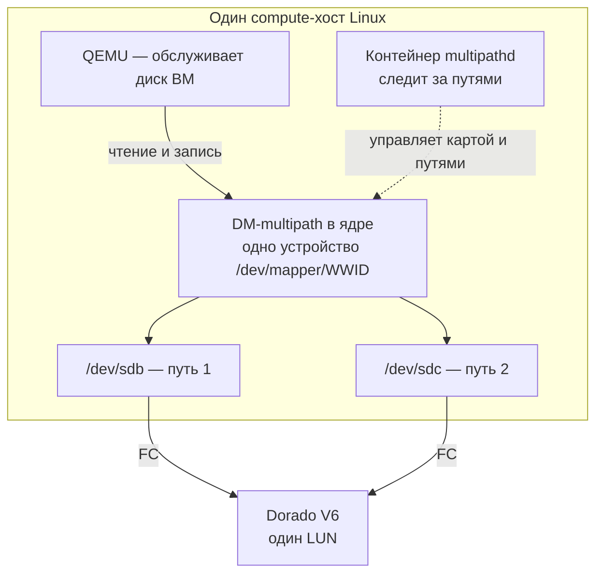

# Multipath и Dorado V6: хост, контейнеры, udev и смысл ошибок

Дата: **14.10.2026**.

Объяснение для схемы **Dorado V6 → Fibre Channel → Linux DM Multipath →
OpenStack/Kolla**. Число путей и имена устройств ниже — пример, а не описание
фактической топологии кластера. Работающие хосты в рамках этого объяснения
не проверялись.

## 1. Что делает multipath

**Multipath объединяет несколько путей к одному и тому же диску.**

Допустим, Dorado предоставляет серверу LUN размером 100 ГБ. LUN здесь —
логический диск, который СХД показывает серверу. Через два FC-пути Linux видит:

```text
/dev/sdb — доступ к этому LUN через первый путь
/dev/sdc — доступ к этому же LUN через второй путь
```

У обоих один идентификатор диска — **WWID**. DM Multipath объединяет пути
в одно устройство `/dev/mapper/<WWID>`. Размер остаётся **100 ГБ**: это доступ
к одним данным, а не два независимых диска.

Если один путь пропадает, multipath может продолжить работу через оставшийся.
Это защита от отказов соединения: кабеля, порта, коммутатора и других элементов
пути. Переключение может сопровождаться паузой; точное поведение зависит
от политики и состояния остальных путей.
[Описание DM Multipath у Red Hat](https://docs.redhat.com/en/documentation/red_hat_enterprise_linux/8/epub/configuring_device_mapper_multipath/configuring-dm-multipath_configuring-device-mapper-multipath).



Сплошные стрелки показывают путь чтения и записи. Пунктир — управление.
На каждом подключённом Linux-хосте свои устройства и multipath-карты.

## 2. Что означает «на хосте» и «в контейнере»

Хост — Linux-сервер, например `compute03`. Контейнеры запускаются на этом
сервере и используют **его ядро**. У каждого контейнера при этом своё файловое
окружение и предоставленный ему доступ к устройствам.

| Компонент | Где работает в рассматриваемой схеме | Что делает |
|---|---|---|
| `dm_multipath` | В ядре хоста | Направляет чтение и запись по путям |
| `multipathd` | В контейнере Kolla | Следит за состоянием путей и управляет multipath-картами |
| Утилиты multipath и os-brick | В контейнерах Nova/Cinder | Помогают подключать, находить и отключать тома |
| `udev` | В ОС хоста | Обрабатывает появление, изменение и исчезновение устройств |

Контейнер `multipathd` в проверенном форке привилегированный и имеет доступ
к хостовым `/dev`, `/run`, `/lib/modules` и `/sys/kernel/config`.
Поэтому он управляет устройствами этого Linux-хоста.

**Чтение и запись ВМ выполняет ядро. Данные не проходят через процесс
`multipathd`.** Этот процесс следит за путями и обновляет управление ими.

Можно запускать управляющий демон системной службой ОС или контейнером.
В проверенной схеме Kolla выбран контейнер. Само наличие хостовых утилит
не требует запуска ещё одного демона для тех же устройств.

Источник по форку: `ansible/roles/multipathd/defaults/main.yml` в предоставленном
`kolla-ansible-pvs`; дерево исходников не включено в этот документационный
репозиторий.

## 3. Почему конфигов несколько

У контейнеров собственные файловые системы. Поэтому одинаковое имя пути
может обозначать разные файлы:

```text
ОС хоста:                /etc/multipath.conf
Контейнер multipathd:    /etc/multipath.conf
Контейнер nova_compute:  /etc/multipath.conf
Контейнер cinder_volume: /etc/multipath.conf
```

**Устройства могут быть общими, а конфиги — разными.** Каждая программа читает
файл в своём окружении. Наличие файла в ОС хоста не создаёт его автоматически
внутри Nova или Cinder.

Отдельно существует подготовленный Ansible файл для демона:

```text
Хост: /etc/kolla/multipathd/multipath.conf
  → mount каталога конфигурации в контейнер
  → kolla_set_configs копирует файл
  → контейнер multipathd: /etc/multipath.conf
```

Это не хостовый `/etc/multipath.conf`. В предоставленном форке доставка
реализована для демона, а в проверенных задачах и JSON-шаблонах Nova/Cinder
доставки такого файла нет.

Отсюда возможная ситуация: **демон работает и обслуживает карту, но утилита
внутри Nova сообщает об отсутствующем конфиге**. Сообщение клиента само по себе
не доказывает остановку демона или потерю всех FC-путей.

## 4. Причём здесь udev

Когда сервер обнаруживает новый FC-путь, ядро сообщает о новом устройстве.
Хостовый `udev` обрабатывает событие: применяет правила, устанавливает права
и создаёт постоянные ссылки на устройства. Правила могут запускать
дополнительные программы. [Документация udev](https://www.man7.org/linux/man-pages/man7/udev.7.html).

Упрощённая последовательность:

```text
Linux обнаружил новый путь к LUN
  → событие ядра
  → udev на хосте применяет установленные правила
  → правило может вызвать хостовую утилиту multipath
  → утилита определяет, относится ли путь к multipath-устройству
```

Такая утилита использует окружение **ОС хоста**, включая его конфигурацию.
Файл внутри контейнера `multipathd` её конфиг автоматически не заменяет.
Поэтому необходимость хостового `/etc/multipath.conf` определяется
установленными правилами и локальными потребителями.

Есть и `kpartx`: он может создавать устройства для разделов внутри
multipath-диска. Если это разделы диска ВМ, дополнительные устройства на хосте
могут мешать отключению тома. Отсюда обсуждение `skip_kpartx`; для хостовых
дисков с нужными разделами, включая SAN-boot, применимость настройки проверяют
отдельно. [Компоненты multipath и связь с udev, раздел 1.4](https://docs.redhat.com/en/documentation/red_hat_enterprise_linux/8/epub/configuring_device_mapper_multipath/configuring-dm-multipath_configuring-device-mapper-multipath).

## 5. Где заканчивается ответственность multipath

Dorado предоставляет LUN и доступ к нему. Linux на каждом подключённом сервере
объединяет доступные пути. Mapping — настройка предоставления LUN определённому
хосту/его инициаторам на СХД.

Если на Dorado сняли доступ к LUN для данного сервера по всем путям, multipath
не сможет вернуть его выбором другого пути. Наличие нескольких кабелей
не заменяет предоставление самого LUN.

Название «Dorado V6» само по себе не определяет готовые настройки выбора
путей. Профиль зависит от конкретной ОС, версии ПО СХД, режима доступа
и топологии. В этом объяснении не предлагается универсальный профиль ALUA
или готовая замена `multipath.conf`.

## 6. Какие разные проблемы обозначают сообщения

**Это сообщения разных уровней. Они могут иметь общую цепочку причин,
но по двум строкам такая связь не устанавливается.**

| Сообщение | Кто сообщает | Что установлено | Что этим не установлено |
|---|---|---|---|
| `/etc/multipath.conf does not exist, blacklisting all devices` | Запущенная утилита multipath; в ранее рассмотренном материале — внутри `nova_compute` | В её файловом окружении нет нужного файла; этот запуск исключает устройства из обработки | Что управляющий демон остановлен, Dorado сняла mapping или уже работающая ВМ потеряла все пути |
| `Logical unit not supported` | SCSI-ответ, который Linux выводит в журнал | Адресуемый logical unit не поддерживается; additional sense `25h/00h` | Почему это произошло, кто изменил mapping и неисправны ли физические диски СХД |
| `I/O error` | Linux/приложение на соответствующем уровне | Операция ввода-вывода завершилась ошибкой | Единственная первопричина ошибки |

Значение `25h/00h` определено в
[таблице SCSI ASC/ASCQ комитета T10](https://www.t10.org/lists/asc-num.txt).
Оно не означает, что OpenStack не поддерживает модель Dorado V6.

### Отсутствующий файл: проблема локального окружения клиента

Пример: Nova запускает утилиту multipath, но внутри `nova_compute` отсутствует
`/etc/multipath.conf`. Исправление — обеспечить доставку и корректное содержимое
файла в этом контейнере. Файл в контейнере демона или в ОС хоста — другие файлы.

В проверенной копии форка найден именно разрыв доставки Nova/Cinder. Изменение
роли должно быть применено к развёртыванию; наличие инструкции в репозитории
не означает, что работающие контейнеры уже исправлены.

### Logical unit not supported: проблема обращения к конкретному LUN

Для Dorado/FC проверяются, например, такие **гипотезы**:

- Нужный LUN больше не предоставляется этому хосту: mapping снят или изменён.
- Обращение идёт с неверным номером LUN либо через путь, для которого нужный
  mapping отсутствует.
- На Linux остался путь к уже отключённому тому, и к нему продолжаются запросы.

Установить вариант можно сопоставлением UUID тома, WWID, SCSI-адреса,
WWPN инициатора, состояния mapping и журналов за один интервал времени.
Одна буква `sdX` не является надёжным идентификатором тома.

### Как проблемы могут оказаться связаны

Один из сценариев, который нужно проверить, а не считать доказанным:

```text
Локальное отключение тома завершилось не полностью
  → путь остался на Linux
  → mapping на СХД был снят
  → к оставшемуся пути пришёл новый запрос
  → SCSI-ответ Logical unit not supported
```

Отсутствующий конфиг мог мешать локальным операциям, но его участие в этой
цепочке необходимо подтвердить журналом. Возможны и независимые проблемы.
В ранее рассмотренных материалах сообщения об отсутствии файла и SCSI-ошибках
относятся к разным узлам (`compute03` и `ctrl01`); показанные kernel-ошибки
и REST-detach также не совпадают по времени. Этих фрагментов недостаточно
для доказательства общей причины.

Доставка конфига устраняет подтверждённый пробел. Она не возвращает снятый
mapping и сама по себе не доказывает исправление `Logical unit not supported`
или `I/O error`. Разбор исходных наблюдений приведён в
[исследовании FC/multipath](openstack_dorado_multipath_investigation.md).

## 7. Связанные инструкции

- [Диагностика и исправление Logical unit not supported](DORADO_V6_LOGICAL_UNIT_NOT_SUPPORTED_RUNBOOK.md) — сопоставление тома и путей, проверка Dorado, восстановление mapping и условная очистка отключённого тома.
- [Доставка конфигов ITkey и рекомендации для PVS](ITKEY_MULTIPATH_DELIVERY_COMPARISON.md) — схемы рендера, подготовка хостов, хостовый конфиг и границы проверки.
- [Исправление доставки в Nova/Cinder](KOLLA_MULTIPATH_NOVA_CINDER_FIX.md) — точки изменения Kolla-Ansible и применение.
- [Glance с Cinder store и multipath](GLANCE_CINDER_MULTIPATH_FIX.md) — условия, при которых файл нужен Glance.

Документ объясняет механизм и различает подтверждённый пробел доставки
и гипотезы причин SCSI-ошибок. Код форка, конфигурация хостов и СХД не изменены.
